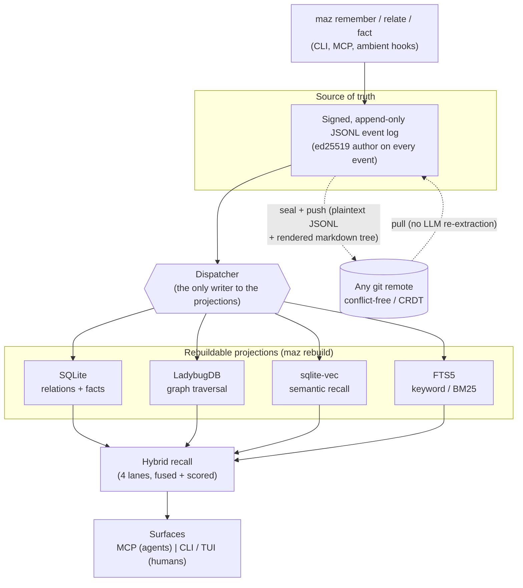
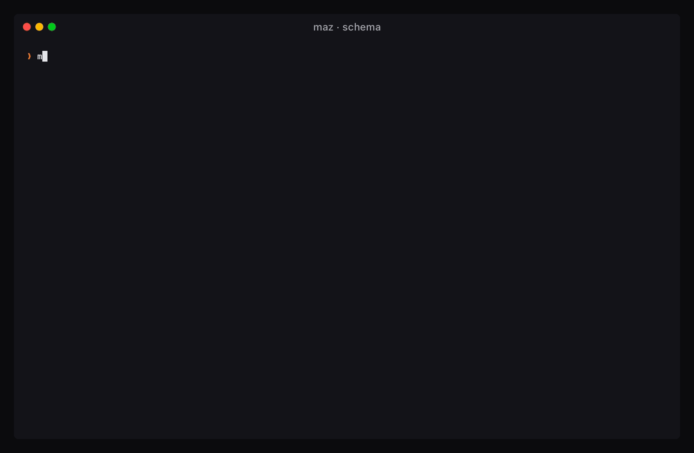
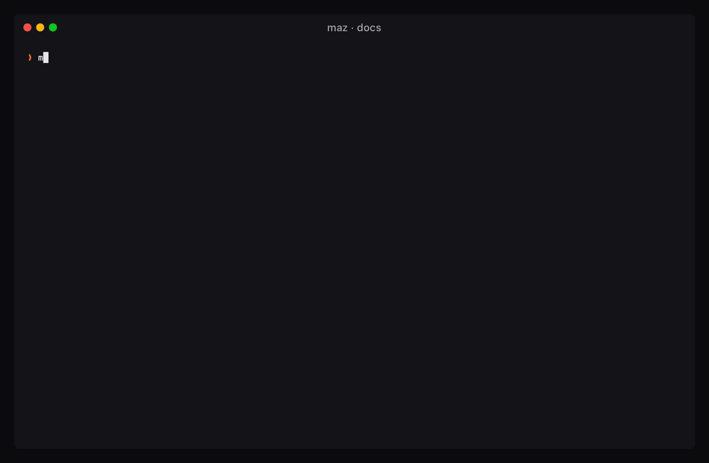

<div align="center">

# Mazarbul

### The system of records for the era of agents.

**Local-first, git-native memory and structured data for your AI agents. One Go binary. Talks [MCP](https://modelcontextprotocol.io). Your data never leaves your machine.**

[](LICENSE)
[](go.mod)
[](https://modelcontextprotocol.io)
[](#install)
[](#use-with-claude-code-and-any-mcp-agent)


</div>

## What is Mazarbul

Your agents have anterograde amnesia. They forget everything between sessions, so you re-explain your codebase, your preferences, and your decisions every single time. The usual fixes do not hold: a `CLAUDE.md` caps out and goes stale, a markdown vault is not a database, and cloud memory is an opaque blob you cannot query, audit, or own.

Mazarbul is the place your agents remember. A single local binary, `maz`, that any [MCP](https://modelcontextprotocol.io)-aware agent (Claude Code, Cursor, your own) talks to. Under the hood it is an append-only, cryptographically signed event log, projected into a graph, a vector index, and full-text search, and synced over plain git. Every fact carries its source. Nothing phones home.

It is both a memory for free-text episodes and a real database for typed entities, relations, and facts you can query. Think of it as a personal knowledge graph, a CRM, a decision log, and an agent memory, in one file you own.

And it runs headless. One lean binary gives you a CLI and an MCP server, with no separate database server to stand up and no UI required. So anything that needs to persist structured or unstructured data can lean on it: an agent over MCP, a script or cron job that shells out to `maz`, or you at the command line. Mazarbul is a local data layer you can drop into virtually anything.

**What makes it different:**

- **Event-sourced and signed.** Every memory is an immutable, ed25519-signed event. The log is the source of truth; the indexes are rebuildable derivatives. Nothing is silently overwritten.
- **Four-layer hybrid recall.** Vector similarity, full-text BM25, graph traversal, and name-embedding, fused into one ranked result with the score breakdown visible.
- **Git-native, conflict-free.** Plaintext JSONL syncs over any git remote. Two devices converge by construction (CRDT), so concurrent writes never overwrite each other.
- **Provenance and audit on every fact.** `maz blame` shows who changed what and when, like `git blame` for your agent's memory. No other memory layer treats this as first-class.
- **Structured and unstructured.** Free-text `remember`, plus typed entities, relations, and facts you define and query. A database, not a pile of notes.
- **Reference your live tools, don't copy them.** Your agent is already connected over MCP to Notion, Linear, Drive, and more. Mazarbul indexes them with a pointer, a short summary, and a freshness anchor, never the body, so recall spans your own memory and your live sources at once with nothing duplicated.

## Your agent is the brain, Mazarbul is the memory

The agent that calls Mazarbul over MCP (Claude Code, Cursor, your own) is already a strong model, so let it do the reasoning. It decides what is worth remembering, writes entities, relations, and facts with the structured tools (`createEntity`, `relate`, `fact`), resolves duplicates, and answers your questions from what `recall` and `getContext` return. Mazarbul stores, indexes, recalls, and proves where every record came from. That is why `maz init` configures no server-side chat model by default: you need only a small local embedding model for semantic recall, not a second LLM. A server-side model (Anthropic or a local Ollama model) is an optional extra that helps only when no agent is in the loop: passive file watching, connector ingestion, `maz ask` from a plain terminal, and background consolidation.

## Install

```bash
curl -fsSL https://raw.githubusercontent.com/mo-cmyk/mazarbul/main/scripts/install.sh | sh
```

Or with Homebrew (macOS and Linux):

```bash
brew install mo-cmyk/mazarbul/maz
```

The installer verifies the download checksum, places `maz` plus its bundled engine library and man pages, and sets up a local model provider (it installs [Ollama](https://ollama.com) and pulls the embedding model semantic recall needs, unless you opt out with `--no-ollama`). It pulls no chat model: your agent does the reasoning. Then run `maz init`. If you want Mazarbul to reason on its own as well (agent-less ingestion, `maz ask`), add `--with-chat-model` to the installer for a local model, or run `maz init --provider anthropic --api-key ...` for a remote one.

**MCP Registry / one-click bundle.** Every [release](https://github.com/mo-cmyk/mazarbul/releases) ships a `mazarbul_<tag>_<os>_<arch>.mcpb` MCP Bundle per platform that Claude Desktop and other MCPB clients install directly. It runs `maz mcp serve` against your default data dir, so it shares memory with the CLI (run `maz init` once to pick a provider). Each release is also published to the [official MCP Registry](https://registry.modelcontextprotocol.io) as `io.github.mo-cmyk/mazarbul`, which registry-aware clients and directories pick up.

<details>
<summary><b>Build from source</b></summary>

```bash
# Prerequisites: mise (https://mise.jdx.dev), git.
git clone https://github.com/mo-cmyk/mazarbul.git
cd mazarbul
mise install          # provisions Go, golangci-lint, lefthook, vhs, ...
mise run setup        # go mod download + engine lib + hooks
mise run build        # builds ./bin/maz (with sqlite_fts5)
./bin/maz --help
```

`maz` dynamically links a small native graph engine (LadybugDB), resolved via an rpath into your Go module cache, so a source build runs on the machine that built it. For a self-contained, relocatable binary that bundles the engine, use the installer above.

</details>

## Quickstart: zero to agent memory

```bash
# 1. Initialize your Book: pick a data dir; keep the default "no server-side
#    chat model" (your agent reasons) or opt into one. Turn on encryption and
#    init shows a recovery Watchword to save (your only key).
maz init

# 2. Wire it into Claude Code over MCP. --capture records each session passively;
#    --warm-start injects a context brief when a new session begins.
maz connect claude-code --capture --warm-start

# 3. Remember something. Over MCP your agent also writes the entities and
#    relations it sees; with a server-side chat model, maz extracts them too.
maz remember "Frodo Baggins works at Bag End in the Shire as a ring-bearer."

# 4. Recall it. Hybrid search (vector + full-text + graph + name-embedding), scored.
maz recall "where does Frodo work"
```

That is it. Claude Code now has a `recall` and `remember` tool pointed at your Book, and every session it works in gets remembered and fed back. Any other MCP agent connects the same way via `maz mcp serve`.

## How it works

The event log is the source of truth. Everything else is a rebuildable projection of it.



Because the log is append-only and every event is immutable and signed, two devices that sync the same log converge to byte-identical state. There is no last-write-wins overwrite. If any index is ever corrupted, `maz rebuild` reconstructs all four from the log.

## A database for your agents, not a pile of notes

This is the core of it. Mazarbul stores free text *and* structured data, and lets you query both.

```bash
# Define a typed entity kind and a custom relation, on the fly. An agent can do
# this over MCP too; the ontology is data, so it syncs and versions like the rest.
maz schema kinds add artifact --display-name "Artifact" --description "An object of power"
maz schema predicates add bears --description "carries an object of power"

# Preview what defineEntityKind would do before committing (mint / collapse / supersede):
maz schema preview kind artifact --description "An object of power"

# Mint structured entities with typed properties, then wire the graph by name.
# relate takes names or ULIDs and requires both endpoints to already exist.
maz entity create person "Frodo Baggins"
maz entity create artifact "The One Ring" --attributes '{"forged_in":"Mount Doom","power":"invisibility"}'
maz relate "Frodo Baggins" bears "The One Ring"

# Read it back: typed kind, typed properties, provenance, and the new relation.
maz get "The One Ring"
maz neighbors "Frodo Baggins"

# Assert a scalar fact with history. Later writes supersede the value but keep the
# old one, so you can still ask where the Ring-bearer was earlier in the journey.
maz fact set "Frodo Baggins" location "Rivendell"
maz fact get "Frodo Baggins"

# Close a fact that stopped being true (keeps history), or hard-delete one outright.
maz fact retract "Frodo Baggins" location   # slot reads empty after; history preserved
maz forget facts/01ARZ3NDEKTSV4RRFFQ69G5FAV  # remove a fact row entirely

# Query the lot with one hybrid recall over structured data and free text, and
# pin the view to a point in time (valid-time).
maz recall "who carries the ring"
maz recall "who carries the ring" --at 2026-01-01T00:00:00Z   # facts as they were valid on Jan 1
```



Pure markdown cannot query, join, or track change. Pure vector search [cannot connect facts across documents](https://www.microsoft.com/en-us/research/blog/graphrag-unlocking-llm-discovery-on-narrative-private-data/). Mazarbul gives you typed entities and relations with a queryable graph, *and* the free-text episodes, fused in one recall.

## What you can do

Mazarbul is a universal, headless data layer and system of record. The same primitives become many tools:

- **Agent memory.** The default. `remember` facts, `recall` them across sessions. Stop re-explaining your project to every agent.
- **Notes and knowledge vault.** `maz doc import ~/notes` pulls your markdown in; wikilinks resolve to entities; `maz doc log` and `maz doc diff` give every note a history.
- **Personal CRM.** People, organizations, and the relations between them (`works_at`, `reports_to`, `introduced_by`). Capture how and why you met someone, not just a name.
- **Decision log / ADRs.** Append-only by design, with supersede links. The reasoning behind a decision survives, and stays queryable, long after you would have forgotten it.
- **Knowledge graph.** Define domain kinds and predicates, install schema packs, and traverse the result.
- **Team brain.** A shared, end-to-end-encrypted scope so a whole team's agents draw on the same memory.

### Draft staging: stage before you commit

Sometimes you want to capture something without immediately making it part of your permanent memory. Write with `--scope draft` and it lands in a private staging area, invisible to `recall`, `get`, and every other read verb until you decide what to do with it:

```bash
# Stage privately. Nothing in recall or getContext sees this yet.
maz remember "rough notes from the Prancing Pony meeting" --scope draft

# Review what is staged.
maz scope draft list            # episodes, entities, and relations in staging
maz scope draft diff            # compare draft against your personal set side by side

# Promote into personal memory (now recall-able and sync-able).
maz scope draft promote episodes/01ARZ3NDEKTSV4RRFFQ69G5FAV

# Or throw it away. The audit event is appended; the projection is cleaned up.
maz scope draft discard episodes/01ARZ3NDEKTSV4RRFFQ69G5FAV
```

Promotion always targets `personal` (or `project`). Promoting directly into a shared `team` scope is refused by design — unreviewed draft data should never land in a shared scope without an explicit team write. Discard removes the episode and all draft entities it created; the event log itself is append-only, so the audit trail is preserved.

### Named recall shortcuts

Save a query once, replay it whenever you need it:

```bash
maz saved add standup --query "daily standup Berlin team" --limit 5
maz saved list                          # all saved queries
maz saved show standup                  # stored parameters
maz saved recall standup                # run it through the live recall pipeline
maz saved remove standup
```

Saved queries live in your Book's `config.toml` under `[saved_recalls]`. Replaying always hits the live index, so results evolve as new episodes arrive.

## Build your own skills and ontology

A **preset** is a skill for your agent: a schema pack (entity kinds and predicates) plus an `instructions.md` that teaches the agent when and how to use them. Install one, author your own, or publish it for others.

```bash
maz install schema-org-core           # built-in pack: common schema.org types
maz install business-de               # built-in pack: German business + legal types
maz preset install agent-memory       # teaches an agent when to reach for memory
maz preset install second-brain       # life-graph: people, projects, notes, topics
maz preset install decision-trace     # decision provenance: decisions, insights, principles
maz preset install github.com/you/your-preset   # install a preset from any git repo
maz preset package ./my-preset        # validate + print a checksum to publish
```

Once `second-brain` is installed, it seeds `brain:Person`, `brain:Project`, `brain:Note`, and `brain:Topic` kinds with relations like `collaborates_on`, `tagged_with`, and `inspired_by`. Try a recall after adding a few notes to see how the graph organizes them. `decision-trace` seeds `decision`, `insight`, and `principle` kinds and wires them together with first-class traceability edges.

Define types ad hoc with `maz schema kinds add` / `maz schema predicates add`, or let an agent define them over MCP with `defineEntityKind` / `definePredicate`. Use `maz schema preview kind <name>` to see the plan (mint / collapse-into / supersede) before writing. The ontology is data, not code, so it syncs and versions like everything else.

## Bring your existing tools

Mazarbul meets your data where it already lives.

```bash
# Import an existing markdown / Obsidian vault. Wikilinks become entities;
# bodies become recall-able. Idempotent, so re-running skips unchanged files.
maz doc import ~/ObsidianVault

# Or point Mazarbul's vault straight at your Obsidian folder (it only ever writes
# documents it owns) and edit notes in Obsidian as usual.
maz config set vault.path ~/ObsidianVault

# Render an entity neighborhood as an Obsidian-openable canvas.
maz doc canvas "Frodo Baggins"

# Pull in your other sources. Connectors ingest untrusted external content, so
# the target scope needs encryption enabled first (maz doctor sets it up).
maz source connect local-git --repo .              # your repo's commit history
maz source import claude-chats ~/Downloads/export.zip   # your Claude.ai exports
```



This is "Karpathy-style" external memory (an agent that compiles a persistent, interlinked base instead of re-deriving everything per query) with the parts the markdown-wiki approach lacks: a typed query layer, an automatic entity graph, provenance, and a sync that does not corrupt.

### Reference live sources instead of copying them

Importing copies data in. The other half is the opposite. Your agent is already connected, over MCP, to the tools your work actually lives in: Notion, Linear, Granola, Google Drive, GitHub. Mazarbul holds no tokens for any of them and never fetches them itself. It indexes them.

After your agent reads an item from one of those tools, a single `captureExternal` call records a pointer to it, the agent's own short summary, and a freshness anchor (a content hash plus the fetch time). The body never lands in Mazarbul. That summary is then searchable in `recall` alongside everything else you remember, and every hit grounded in a live source carries an inline freshness verdict and an external-lineage marker:

```text
recall "the Q3 launch plan"
  Q3 launch: connector wave ships first, then the public install path.
    source: notion   freshness: fresh (fetched 2h ago)   trust: proposed
```

When a hit goes `stale` (past that connector's freshness budget) the agent re-fetches the live item and re-captures, so the index never drifts from the source of truth. And because the lineage is external rather than authored, these land `proposed`, untrusted: searchable and rankable, but clearly summarized-from-elsewhere, not something you asserted. See [`agent-docs/external-references.md`](agent-docs/external-references.md).

The result is one place to search across your own memory and your live tools at once, with no second store to keep in sync.

## It's just git

Your memory is plaintext JSONL plus a rendered markdown tree in a normal git repo. Inspect it with semantic, entity-aware commands, or with the git you already know.

```bash
# Seal local memory into signed chunks and push to your git remote.
maz sync push

# Browse it semantically, from anywhere:
maz diff HEAD~5..HEAD         # what changed: entities added, relations superseded
maz diff --kind person --operation changed --format json   # changed person entities as JSON
maz blame "Frodo Baggins"     # who changed this entity, and when
maz changelog                 # per-push summaries, newest first

# Or clone the synced repo and use plain git. It is JSONL plus a rendered markdown
# tree, so log, diff, and blame all just work on it:
git clone <your-remote> memory && cd memory
git log --stat
git blame rendered/by-uid/<...>.md   # line-level provenance, in plain git
```

`maz diff` also takes `--predicate` and `--operation` post-filters. JSON output (`--format json`) surfaces a `filtered` count and an `active_filters` map alongside the entries, so scripts can assert what changed without parsing prose.

### Bulk import and re-embedding

Moving machines, restoring from a backup, or switching embedding models? Two commands cover it:

```bash
# Bulk-load a JSONL snapshot exported with "maz export".
maz load backup.ndjson                    # append every event (default)
maz load backup.ndjson --mode merge       # skip events whose UID already exists (idempotent)
maz load backup.ndjson --dry-run          # parse + validate, report counts, write nothing

# After switching embedding models, re-embed every episode.
maz reindex --reembed                     # drop episodes_vec and rebuild it
maz reindex --reembed --dry-run           # count what would be re-embedded first
```

`maz load` emits `{mode, source, total, appended, skipped, invalid, dryRun}`. Warning `MAZ-LOAD-001` fires when merge mode skips duplicate UIDs; `MAZ-LOAD-002` when a line is malformed. The batch is atomic: either all valid events land or none do. `maz reindex --reembed` requires an embedder configured (`maz init --embed=ollama`); the other three derived stores (SQLite, graph, FTS5) are untouched.

**Both `maz rebuild` and `maz reindex --reembed` run with the daemon up.** No `maz daemon stop` is required. When the daemon is running, the CLI routes these operations to the admin HTTP interface (`POST /admin/v1/rebuild`, `POST /admin/v1/reindex`), which is exposed only on the Unix socket, not TCP. The daemon builds a shadow projection in a temporary directory, quiesces for a brief swap window (seconds), renames the new indexes into place, and resumes serving on the same socket. The reconnecting `maz mcp serve` proxy masks the window for read traffic; in-flight writes fail clean and can be retried. `maz reindex --dry-run` is unavailable while the daemon runs (it requires in-process store access). The same socket-only `/admin/` surface is how `maz preset install`, `maz preset uninstall`, `maz load`, and `maz schema` alias operations route privileged writes through the live daemon.


Markdown vaults synced over git [overwrite each other on concurrent writes](https://news.ycombinator.com/item?id=36610268). Mazarbul's log is conflict-free by construction, so two machines pushing at once converge instead of clobbering. For an untrusted host, turn on per-scope encryption (XChaCha20-Poly1305) and the repo holds only sealed ciphertext.

## Why Mazarbul

You are probably already doing this with one of these. Here is what Mazarbul gives you instead.

- **Obsidian + Claude Code + git.** You get markdown silos, manual linking, no query or join, git sync that corrupts on concurrent writes, and provenance only if you hand-enforce it. Mazarbul keeps the git-native plaintext and adds a typed query layer, an automatic entity graph, conflict-free merge, and provenance on every fact.
- **Agent-memory libraries (mem0, Letta, agentmemory).** A vector store, a cloud API, or a framework you are locked into; memories are opaque, LLM-rewritten blobs with [no provenance or audit](https://blog.getzep.com/stop-using-rag-for-agent-memory/). Mazarbul is local, four-layer, event-sourced, and every fact cites its source and is auditable.
- **Key-value or vector stores, ChatGPT / Claude built-in memory.** Opaque, cloud-locked, no schema or relations or query or audit, siloed per product. Mazarbul is a system of record you own, query, time-travel, and move.

| | Mazarbul | Vector memory (mem0, ...) | Obsidian + git + agent | Built-in cloud memory |
|---|:---:|:---:|:---:|:---:|
| Runs fully local, no account | yes | partial | yes | no |
| You own the source of truth | signed event log | cloud / vector blobs | markdown files | vendor cloud |
| Provenance + audit per fact | yes | no | manual | no |
| Typed query + graph | graph + vector + FTS | vector (+opt. graph) | no | no |
| Conflict-free multi-device git | yes | n/a | overwrites | n/a |
| Time-travel (valid-time) | yes | no | no | no |
| MCP-native for any agent | yes | SDK / REST | via plugins | vendor-only |
| Shared encrypted team scope | yes | cloud tier | manual | no |

The wedge, in one line: agents need both free text and structure, and the systems that combine them ([GraphRAG](https://www.microsoft.com/en-us/research/blog/graphrag-unlocking-llm-discovery-on-narrative-private-data/), [Zep](https://blog.getzep.com/stop-using-rag-for-agent-memory/)) all live in the cloud. Mazarbul brings that combination to a single file you own, with provenance and git-native sync no one else offers.

## Use with Claude Code and any MCP agent

```bash
maz connect claude-code               # register over MCP (also: claude-desktop, ...)
maz connect claude-code --capture --warm-start   # passive capture + session warm-start
maz connect                           # show the live detection table for every client
```

Once connected, Claude Code works from your Book, traversing the graph to connect facts rather than just retrieving text. The same memory answers a headless `claude -p` one-shot and a live interactive session, with no tool list and no prompts:


For Cursor, a custom agent, or any other MCP client, run the server directly:

```bash
maz mcp serve            # stdio (default)
maz mcp serve --http     # streamable HTTP at 127.0.0.1:7842
maz mcp serve --unix     # Unix socket
```

Connected agents get a clean tool surface: `remember`, `recall`, `forget`, `relate`, `get`, `neighbors`, `relations`, `entities`, `query`, `createEntity`, `defineEntityKind`, `getContext`, `getEntityContext` (a token-budgeted dossier for one entity), `agentFeedback`, and more. The humans on your team use the exact same data through `maz` on the command line or its TUI.

### For humans: TUI, live watch, and the Agent Mirror

The same memory has rich interactive surfaces — no agent required:

```bash
maz self                       # the Agent Mirror: what Mazarbul knows about you
maz recall "the ring" --tui    # interactive master-detail recall browser (recall → get → neighbors)
maz doc browse                 # two-pane TUI over your markdown vault
maz watch                      # live dashboard: events, jobs, embedding, and sync
```

## maz learns how it's used

This is the centerpiece of the Omnigraph-parity wave. Every time an agent hits a confusing result, a wrong answer, or a hard-won rule worth keeping, it can record that friction. Recurring friction auto-promotes a distilled one-liner into a `## Known gotchas & lessons` section that is appended last to every new MCP session's instructions — so every connected agent starts with the evolved guidance, without any human curation step.

```bash
# Record a durable lesson from the CLI (agents use the agentFeedback MCP tool).
maz feedback record --category lesson --severity medium \
  --surface recall \
  --summary "recall missed an exact name" \
  --rule "prefer get when you already hold the exact name"

# See what is currently promoted into every session's instructions.
maz feedback gotchas

# Inspect the raw triage queue.
maz feedback list --category confusing

# Pin a cluster (always included, even if the cap fills up).
maz feedback pin "lesson|recall|prefer get exact name"

# Suppress a cluster from promotion.
maz feedback veto "lesson|recall|prefer get exact name"

# Edit the distilled rule text.
maz feedback edit "lesson|recall|prefer get exact name" --rule "use get for exact-name lookups"

# Export an allowlist-redacted diagnostic (safe to share; no user memory ever leaves).
maz feedback export --format md -o feedback.md
```

Promotion thresholds: a cluster promotes after 3 recurrences, or 2 when its highest observed severity is `high`. Pinned clusters are exempt from the 8-entry cap; vetoed clusters never appear. Every review appends an audited event — nothing is ever deleted. The export strips all user memory, principal IDs, cluster keys, and team scope: only `{id, ts, category, severity, surface, summary, detail, keywords, version, activePreset}` leaves. See [`agent-docs/feedback-loop.md`](agent-docs/feedback-loop.md) for the full design.

## Output formats and scripting

Every read verb honors `--output` (or the `MAZ_OUTPUT` env var):

```bash
maz recall "Frodo" --output json          # single JSON document
maz entities --kind person --output ndjson  # one JSON object per line (stream-friendly)
maz entities --kind person --output csv     # CSV with a header row (cut/awk/spreadsheet)
maz entities --kind person --output kv      # key: value lines, blank between records (grep-friendly)
```

Aliases: `table` = `text`, `jsonl` = `ndjson`. Set a persistent default in your Book config:

```bash
maz config set output.default_format json
```

The config knob sits between `MAZ_OUTPUT` and the TTY heuristic in the precedence chain, so scripts get JSON automatically while interactive sessions still get a table.

## Documentation

- Architecture and design: [`agent-docs/synthesis.md`](agent-docs/synthesis.md), [`agent-docs/designs/`](agent-docs/designs/)
- Sync, scopes, and teams: [`agent-docs/sync.md`](agent-docs/sync.md), [`agent-docs/privacy.md`](agent-docs/privacy.md)
- Connectors and presets: [`agent-docs/connect.md`](agent-docs/connect.md), [`agent-docs/plugins.md`](agent-docs/plugins.md)
- Draft staging workflow: [`agent-docs/draft-scope.md`](agent-docs/draft-scope.md)
- Dynamic feedback loop: [`agent-docs/feedback-loop.md`](agent-docs/feedback-loop.md)
- Warning codes: [`agent-docs/warnings.md`](agent-docs/warnings.md)
- Built-in help: `maz help-topics concepts`, `maz introspect`, `man maz`

A hosted documentation site is on the way.

## Contributing

- Humans: start with [DEVELOPMENT.md](DEVELOPMENT.md) and [CONTRIBUTING.md](CONTRIBUTING.md).
- Agents: read [AGENTS.md](AGENTS.md) for the operating contract and subagent roster.
- Security: see [SECURITY.md](SECURITY.md) for private disclosure (do not open public issues for vulnerabilities).

## License

Mazarbul is licensed under the Apache License 2.0. See [LICENSE](LICENSE) for the full terms and [NOTICE](NOTICE) for attribution.
