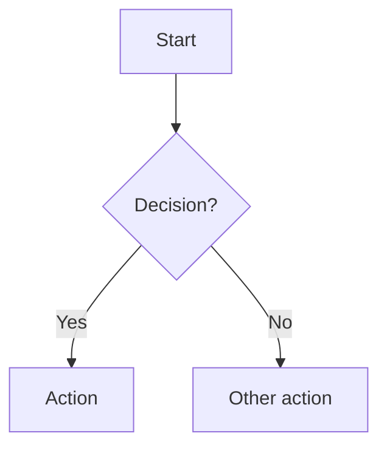

# Design Document Template

Copy this template to `.claude/plans/PLAN-{YYYYMMDD}-{kebab-case-feature}.md` before filling it in. See `AGENTS.md` for when a design document is required. `.claude/plans/` is gitignored, so the plan file is local scratch for aligning with the user before coding; the durable artifact is the implementation plus the PR description, not the plan file itself.

---

```markdown
# [Feature Name] Design Document

**Status**: Draft | In Review | Approved | Implemented
**Author**: [name]
**Created**: [YYYY-MM-DD]
**Last updated**: [YYYY-MM-DD]

## Context

[1-2 paragraphs: what problem are we solving and why now? What is the cost of not solving it? Link to relevant agent-docs and existing code.]

## Goals

- [ ] Goal 1, measurable outcome
- [ ] Goal 2

## Non-goals

- Not in scope: ...
- Explicitly excluded: ...

## Proposal

### Data model

[New event types, JSON Schemas, Go structs. Include field names, types, AIP-compliant naming. Note provenance fields, timestamp policy.]

```jsonc
// Example: new event type
{
  "name": "events/01HNX...",
  "kind": "MyEntityCreated",
  "createTime": "2026-05-23T17:58:00Z",
  "source": "providers/anthropic",
  "confidence": 0.95,
  "payload": { ... }
}
```

### API

[New or changed MCP tools / HTTP endpoints / CLI commands. Include request and response schemas. Note error codes.]

```jsonc
// Example: new MCP tool input schema
{
  "name": "myEntity.create",
  "description": "Create a new MyEntity (Required: displayName)",
  "inputSchema": {
    "type": "object",
    "properties": {
      "displayName": { "type": "string", "description": "Required. Human-readable label." },
      "parent": { "type": "string", "description": "Optional. Parent resource name." }
    },
    "required": ["displayName"]
  }
}
```

### Business logic

[Key algorithms or decision flows. Mermaid diagrams for complex flows.]



### Storage impact

[Does this change touch the event log, graph, vector, or FTS5 indexes? If yes, describe schema migration and rebuild semantics. Confirm append-only is maintained.]

### Privacy and provenance

| Concern | Impact | Mitigation |
|---|---|---|
| Provenance attached | [Yes/No] | [source + confidence + timestamp on every fact] |
| Scope tagging | [Yes/No] | [tagged at write time] |
| Append-only invariant | [Yes/No] | [no UPDATE/DELETE on event log] |
| Audit log entry | [Yes/No] | [for reads of non-public scopes] |

### TUI impact

[New screens? Modified flows? Theme implications? Run through `agent-docs/tui-design.md` for the design system.]

## Alternatives

| Option | Pros | Cons | Why rejected |
|---|---|---|---|
| Option A | ... | ... | ... |
| Option B (chosen) | ... | ... | Chosen because ... |

## Risks

- Risk 1: ... Mitigation: ...
- Risk 2: ...

## Migration

[If this PR includes an event-log schema bump: what does it do? Is it backwards-compatible (can old clients still parse new events)? Any rebuild required on `maz pull`?]

## Acceptance criteria

- [ ] Phase 1: JSON Schema / event type defined
- [ ] Phase 2: Kernel implementation with append-only guarantees
- [ ] Phase 3: Index hooks (graph, vector, FTS5 as relevant)
- [ ] Phase 4: MCP tool / CLI command / HTTP endpoint
- [ ] Phase 5: TUI surface if user-facing
- [ ] Phase 6: Tests (unit + integration + teatest snapshots if TUI)
- [ ] Phase 7: Docs (`agent-docs/`, Mintlify `docs/`)

Estimated effort: [X days]

## Open questions

- [ ] Question 1 (owner: @name, needed by: [date])
- [ ] Question 2

## Approval

- [ ] Reviewed by: [name]
- [ ] Architecture decisions agreed upon
```
