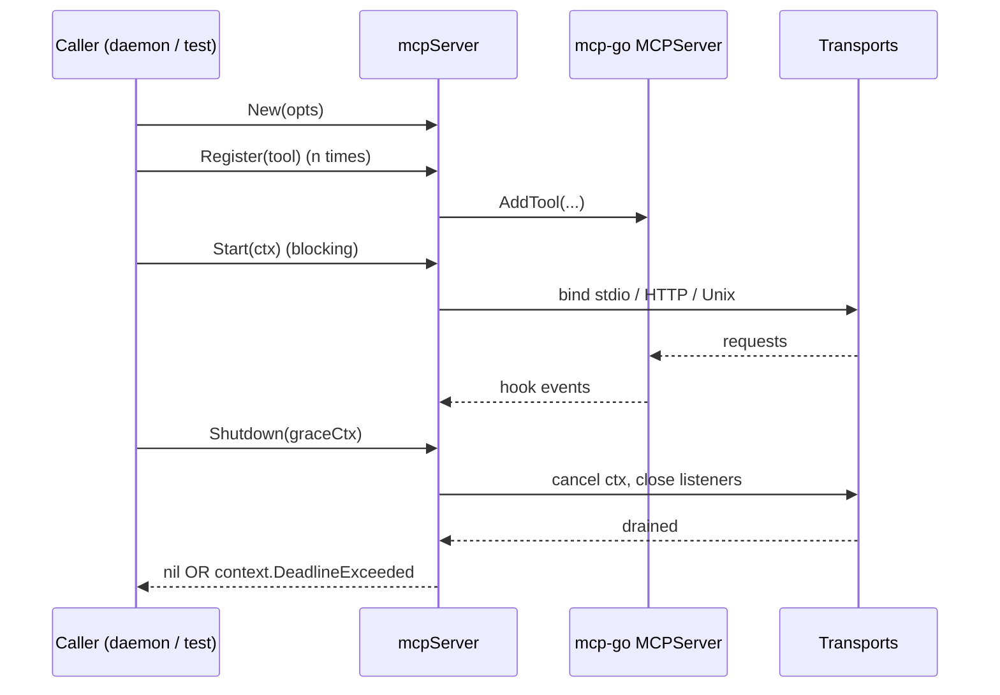

# MCP Server Design Document

**Status**: In Review
**Author**: Moritz
**Created**: 2026-05-24
**Last updated**: 2026-05-24
**Issue**: [#23](https://github.com/mo-cmyk/mazarbul/issues/23)
**Parent epic**: [#14](https://github.com/mo-cmyk/mazarbul/issues/14)

## Context

Mazarbul's MCP surface is the agent-callable bridge: every coding agent (Claude Code, Cursor, Codex, Gemini CLI, OpenCode, Windsurf, Cline, GitHub Copilot CLI, Continue, Zed) reaches the kernel through it. Before this PR, `internal/mcp/` held only the interface contract from PR #9 plus a `NoopServer` stub; nothing actually served JSON-RPC.

This PR lands the first concrete `Server` implementation by wrapping [`mark3labs/mcp-go`](https://github.com/mark3labs/mcp-go). It is the first child of epic #14 and unblocks every subsequent MCP tool issue, including the remember + recall tools (epic #16) that M1 needs end-to-end.

Cost of not landing this: M1 walking skeleton has no agent-callable surface. The tool-registration scaffold and daemon supervisor (#15) have nothing to host.

## Goals

- [ ] `New(opts Options) (Server, error)` returns an mcp-go-backed server behind the `mcp.Server` interface.
- [ ] `Options` carries server name, version, logger, secret-provider hook, and transport selectors (stdio, HTTP, Unix socket).
- [ ] `Server.Start(ctx)` blocks until shutdown; `Server.Shutdown(ctx)` drains in-flight requests with `context.DeadlineExceeded` semantics on grace excess.
- [ ] Every tool invocation logs `tool`, `request_id`, `duration_ms`, `status` via the configured zap logger.
- [ ] Race-clean tests round-trip a no-op tool over stdio and HTTP.

## Non-goals

- The higher-level **tool registration mechanism** (registry, JSON Schema attachment, error envelope shaping). Sibling issue under epic #14.
- **Remember / Recall tool implementations** (epic #16).
- **HTTP / Unix-socket production tuning** (TLS, auth, rate limiting, observability beyond logging).
- **`maz mcp serve` CLI command and daemon supervisor** (sibling epic #15). The MCP server stays signal-agnostic; the supervisor wraps it.
- **OpenTelemetry**. `internal/observability` is still a stub.

## Proposal

### Data model

No new event types. The MCP server is a transport-layer wrapper; entities still live in `internal/entity`, the event log in `internal/kernel`. The only new types are:

- `mcp.Options` (Go struct, no JSON tags yet).
- `mcp.SecretProvider` (interface).
- `mcp.NoopSecretProvider` (default impl).
- `mcp.ErrSecretNotFound` (sentinel).

The existing `mcp.Tool` and `mcp.Server` interfaces from PR #9 stay, with `Server.Serve(ctx, opts)` replaced by `Server.Start(ctx)` (transport selection moved to `Options` at construction time).

### API

```go
// internal/mcp/types.go
type Server interface {
    Register(tool Tool) error
    Start(ctx context.Context) error
    Shutdown(ctx context.Context) error
}

// internal/mcp/options.go
type Options struct {
    Name            string
    Version         string
    Logger          *zap.Logger
    Secrets         SecretProvider
    Stdio           bool
    HTTPAddr        string
    UnixSocket      string
    ShutdownTimeout time.Duration
}

type SecretProvider interface {
    Secret(ctx context.Context, name string) (string, error)
}
```

Tools register via `srv.Register(tool)` and consume secrets in `Invoke` via `mcp.SecretsFromContext(ctx).Secret(ctx, name)`.

### Tool registration wiring

Tool implementations live in `internal/mcp/tools/` (sub-package), one per file. The M1 surface is **exactly four canonical verbs**:

| Verb     | File             | Wraps                          | Notes                                              |
|----------|------------------|--------------------------------|----------------------------------------------------|
| remember | `remember.go`    | `kernel.EventLog.Append`       | Episode append; extractor runs async              |
| recall   | `recall.go`      | `*kernel.HybridQuery.Recall`   | Four-lane RRF; accepts `at` (valid-time) + `asOf` (tx-time) |
| ask      | `ask.go`         | `HybridQuery` + `composer.New` | RAG over recall hits; accepts the same temporal anchors |
| forget   | `forget.go`      | `kernel.EventLog.Append`       | Tombstone event; dispatcher cascade-deletes derived rows |

**Architectural principle.** MCP is the agent-facing surface and stays minimal by design: agents reason about memory in four verbs and do not need to know that memory is internally organised into entities, relations, mentions, predicates, or episodes. Power-user introspection (browse entities, walk the graph, review the dispositions queue, dump the JSONL audit slice) is **CLI-only** (`maz list`, `maz traverse`, `maz review`, `maz audit`) and reads the kernel directly without an MCP round-trip. Surfacing those primitives over MCP would cement implementation details as a public contract and force every agent author to learn Mazarbul's internals.

Each tool exports a `NewXxx(deps) *Xxx` constructor that takes the kernel surface it wraps (typically a `kernel.Query` or `kernel.EventLog`) and returns a value satisfying `mcp.Tool`. Keeping tools out of `internal/mcp` itself leaves the server package free of kernel imports.

Production wiring lives in `internal/daemon/wiring.go`. `daemon.OpenWiring(ctx, daemon.WiringConfig{DataDir, Logger})` opens the SQLite store, vector layer, FTS layer, and Ollama embedder (loaded from `${DataDir}/config.toml`, with a hard-coded Ollama fallback when no config has been written yet), constructs a `*kernel.HybridQuery`, and returns a `*daemon.Wired` whose `Tools` slice the caller registers on the server. `Wired.Close(ctx)` tears every resource down in reverse open order.

The daemon supervisor (`internal/daemon/supervisor.go`) and the foreground `maz mcp serve` (`internal/cli/mcp.go`) both call `OpenWiring` between `mcp.New` and `srv.Start`. The supervisor exposes a `SupervisorOptions.NewWiring` injection seam so its lifecycle tests can substitute a fake `*Wired` and exercise PID + signal lifecycle without depending on a live Ollama daemon or sqlite-vec extension.

### Lifecycle



`Start` runs every transport enabled in Options. It blocks on a `select` over the first transport-level fatal error, ctx cancellation, and the internal shutdown channel. ctx cancellation triggers a graceful shutdown bounded by `ShutdownTimeout`.

`Shutdown` is idempotent: a second call observes the already-closed shutdown channel and returns nil.

### Stdio shutdown

The mcp-go library exposes two stdio entry points:

| Function | Context-aware? | Used? |
|---|---|---|
| `server.ServeStdio(srv)` | No, stops only on SIGINT/SIGTERM | No |
| `(*StdioServer).Listen(ctx, in, out)` | Yes, see `server/stdio.go:530` | Yes |

We use `Listen(ctx, ...)` because the supervisor needs ctx-aware shutdown; mcp-go's signal handling is too coarse for a supervised daemon.

**Caveat**: a `bufio.NewReader(stdin)` already blocked on `ReadString` is not interruptible by ctx cancellation. The reader returns only when:

1. Peer closes stdin (observed as EOF), or
2. The next byte arrives, or
3. The process exits.

Acceptable because (a) the supervisor owns process exit, and (b) MCP clients close stdin on disconnect.

### HTTP and Unix-socket transports

Both transports share a single `*mcpserver.StreamableHTTPServer` as their `http.Handler`. We create our own `http.Server` per transport so we can:

- Discover the bound port for tests (`net.ListenConfig{}.Listen(ctx, "tcp", "127.0.0.1:0")` then read `Addr()`).
- Inject `BaseContext` so `Shutdown` cancellation reaches in-flight tool handlers.
- Set `ReadHeaderTimeout` for Slowloris protection.

The `BaseContext` callback returns `serveCtx`, a context cancelled by `Shutdown`. When cancelled, every in-flight request's `req.Context()` is cancelled, propagating into `Tool.Invoke`.

### Observability

Tool-invocation logging fires via mcp-go's `WithHooks(*server.Hooks)`. The hook fans out across three callbacks:

| Hook | Purpose |
|---|---|
| `AddBeforeCallTool` | Store start time in a per-server `sync.Map`. |
| `AddAfterCallTool` | Emit one log line; `status="error"` when `result.IsError`. |
| `AddOnError` | Emit one log line on JSON-RPC error (filtered to `MethodToolsCall`). |

Log shape:

```
INFO Tool invocation tool=echo request_id=9227f2c3... duration_ms=24.7us status=ok
```

`request_id` resolves to `correlation.FromContext(ctx)` first, falling back to mcp-go's JSON-RPC id.

The per-server map is keyed on the JSON-RPC id; `LoadAndDelete` on every terminal hook keeps it bounded.

### Tool adapter

Mazarbul's `Tool` interface is `Invoke(ctx, json.RawMessage) (json.RawMessage, error)`; mcp-go expects `ToolHandlerFunc(ctx, mcp.CallToolRequest) (*mcp.CallToolResult, error)`. The adapter:

1. Passes the tool's JSON Schema through byte-for-byte via `RawInputSchema`.
2. Threads `SecretProvider` onto the ctx with `WithSecrets`.
3. Marshals arguments back to bytes (zero-copy for `json.RawMessage`, otherwise `json.Marshal`).
4. Translates `Invoke` errors to `IsError` content blocks via `mcp.NewToolResultErrorFromErr`. Per MCP spec, application errors belong in tool results so the LLM can self-correct; only transport-level failures use JSON-RPC errors.
5. Wraps JSON results via `mcp.NewToolResultStructured` with a JSON-text fallback for clients that don't read structured content.

### Privacy and provenance

| Concern | Impact | Mitigation |
|---|---|---|
| Provenance attached | N/A | No data plane in the scaffold; provenance is the kernel's job. |
| Scope tagging | N/A | Same. |
| Append-only invariant | N/A | Same. |
| Audit log entry | N/A | Tool-invocation log line is observability, not audit; audit is on the kernel's append path. |
| Secret handling | Tools may read secrets via `mcp.SecretsFromContext` | Default provider returns `ErrSecretNotFound`; real impl lands when the first secret-consuming tool lands. |

## Alternatives

| Option | Pros | Cons | Why rejected |
|---|---|---|---|
| Hand-rolled JSON-RPC 2.0 | Full control | Maintenance burden, no protocol versioning | Mcp-go is community-maintained. |
| Official Anthropic Go SDK | Vendor-supported | Doesn't exist for Go yet | Block on availability. |
| `ServeStdio` instead of `Listen(ctx, ...)` | One-liner | No ctx-aware shutdown | Supervisor needs ctx-aware shutdown. |
| Tool adapter as wrapper struct | Stateful adapter | Larger surface | Function adapter is smaller; no state needed. |
| `StreamableHTTPServer.Start(addr)` directly | Less boilerplate | Cannot discover ephemeral port; no `BaseContext` | Our own `http.Server` gives both. |

## Risks

- **Blocked stdin read on shutdown.** Mitigation: documented above; process exit is the safety net.
- **Mcp-go silently overwrites duplicate tool names.** Mitigation: `Register` pre-checks an in-package `tools` map and returns `ErrToolAlreadyRegistered` before delegating.
- **`sync.Map` start-time leak** if `AfterCallTool` / `OnError` does not fire. Mitigation: `LoadAndDelete` always evicts; mcp-go guarantees one terminal hook per call.
- **Mcp-go listener bypass.** We use mcp-go as an `http.Handler` and own the `http.Server`. If mcp-go relies on its own Start path for some state, we miss it. Mitigation: we also call `streamable.Shutdown(ctx)` so the session sweeper goroutine terminates.

## Migration

None. The `Server` interface evolved within the unreleased `internal/mcp` package: `Serve(ctx, ServeOpts)` deleted, `Start(ctx)` added, `ServeOpts` deleted with its fields absorbed into `Options`. Only `NoopServer` and the new implementation matter; no external callers exist (verified via `grep`).

## Acceptance criteria

- [x] Phase 1: No new event types required.
- [x] Phase 2: No kernel changes; this is transport.
- [x] Phase 3: No index hooks.
- [x] Phase 4: MCP scaffold — `New`, `Register`, `Start`, `Shutdown` in `internal/mcp/`.
- [x] Phase 5: No TUI surface in this PR.
- [x] Phase 6: Tests + benchmark. Race detector clean.
- [x] Phase 7: Design doc (this file); `agent-docs/tech/mcp-go.md` updated; `agent-docs/mintlify-backlog.md` entry appended.

Estimated effort: about 3 days (matches issue `effort:m` label).

### Benchmark baseline (AGENTS.md Rule 10)

```
goos: darwin
goarch: arm64
pkg: github.com/mo-cmyk/mazarbul/internal/mcp
cpu: Apple M1 Pro
BenchmarkServer_Invocation-8           1701495    684.7 ns/op    808 B/op    15 allocs/op
BenchmarkServer_MarshalArguments-8     1903441    592.2 ns/op    336 B/op    11 allocs/op
BenchmarkServer_WrapResult-8           1490608    875.7 ns/op    808 B/op    15 allocs/op
```

In-process dispatch path; transport excluded. Tracked for regression as the kernel and per-tool middleware land.

## Open questions

- [ ] Should `Options.HTTPAddr` accept multiple addresses (multi-NIC binding)? Defer to when a real deployment requires it.
- [ ] Should we expose `BaseContext` as a configuration field for callers that want to inject tracing context? Defer until OpenTelemetry lands.

## Approval

- [ ] Reviewed by:
- [ ] Architecture decisions agreed upon
